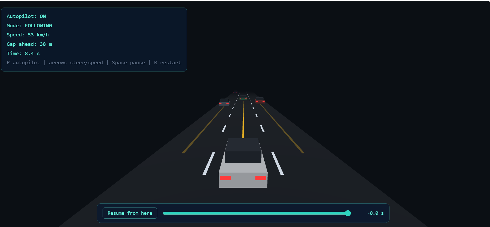

# Autopilot Sim

A browser-based 3D simulator of a self-driving car on a three-lane road. The car reads virtual sensors, follows slower traffic, overtakes when it is safe, and brakes in an emergency. You can pause, drag back through the last 90 seconds of driving, and resume from any moment, so time becomes the fourth dimension.

## What it does

- A 3D road with six cars of traffic, built with Three.js
- Virtual forward sensors, one per lane, drawn as coloured beams on the road: teal means clear, amber means closing, red means close
- An autopilot with four modes: cruising, following, changing lane, and emergency brake
- Manual override: pressing a steering key switches the autopilot off, like grabbing the wheel
- Time travel: pause, drag the slider back (about 90 seconds at 60 fps), and resume from that exact moment. For example, rewind to just before a crash and take over manually.

## How the autopilot decides

Every frame the sensors report, for each lane, the gap to the nearest car ahead and whether the lane is safe to enter (nothing alongside, nothing closing fast from behind). Then:

1. If a collision is less than 2.5 seconds away, brake hard.
2. If the gap is shorter than a safe following distance (8 m plus two seconds of travel), look for a clear neighbouring lane to overtake. If there is none, match the speed of the car ahead.
3. Otherwise, cruise at 90 km/h.

## Test results

`npm test` runs 5 automated tests with Node's built-in test runner. **All 5 pass, 0 fail.**

| Test | What it proves |
|---|---|
| Survives 10 minutes on 50 different roads | No collisions across 50 random traffic layouts, about 8 hours of simulated driving in total |
| Slows down for a slow car close ahead | The target speed never exceeds the speed of the car in front |
| Overtakes when the next lane is clear | The lane-change decision fires when it is safe |
| Never moves into a blocked lane | The safety check wins over the wish to overtake |
| Replay rewind restores the exact moment | Rewinding gives back the identical earlier state |

## Design

The code is split into three files:

- `sim.js`: the simulation and the autopilot. Pure logic with no 3D code, so it can be tested on its own.
- `replay.js`: records snapshots of the whole world so the drive can be scrubbed through time.
- `main.js`: Three.js rendering, the heads-up display and the replay bar.

Keeping the simulation separate from the rendering made both the tests and the replay feature simple. The whole world is one plain object that can be copied, stored and restored.

## Run it

    npm install
    npm run dev
    npm test

Controls: **P** toggles the autopilot, **arrow keys** steer and change speed, **Space** pauses and resumes, **R** restarts.

## Limitations and next steps

- Traffic drives at one fixed speed per lane and never changes lane or cuts in. Making traffic less predictable would be a harder test for the autopilot.
- The sensors are idealised, with no noise or dropouts. Adding noise and checking how the autopilot copes is the obvious next step.
- A learned driver (reinforcement learning) could be compared against this rule-based one.

## Built with

Three.js, JavaScript, Vite, and Node's built-in test runner.
